# FOLIO — Books Library

**A searchable book catalogue, a personal reading shelf, and a record of how the catalogue changes over time.**

[Open FOLIO](https://andpet03.github.io/books-library/) · [Source repository](https://github.com/andpet03/books-library)

FOLIO connects a Python scraper, a Supabase database and a browser interface. The scraper collects the complete catalogue from [Books to Scrape](https://books.toscrape.com/), including individual book details. Supabase stores the books and successive observations; the website turns them into a collection that visitors can search, filter, save and compare.

The verified initial collection contained **1,000 books across 50 categories and 50 catalogue pages**. These are recorded development results, not hard-coded promises about future source data.

> Books to Scrape is a demonstration site. Its prices, stock levels and ratings are sample data, not real purchasing information. FOLIO is an educational project, not a bookshop.

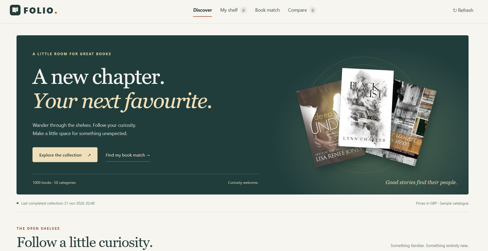

## 1. Purpose and user experience

The project began as a scraping exercise and developed into a usable library interface. The aim was to go beyond printing titles: collect the entire source catalogue, retain its history, keep the database updated independently of a visitor, and make the data useful through an original interface.

| Feature | What a visitor can do |
| --- | --- |
| Discover | Search titles, descriptions and categories; combine category, maximum price, minimum rating and stock filters. |
| Catalogue pages | Browse all matching books in pages of 36, with counts and navigation. The collection is not limited to the first 20 source titles. |
| Book details | Read the description, view the source page, and inspect the UPC, recorded price, stock, rating and collection time. |
| My shelf | Save books, choose a reading status and write personal notes. |
| Backup and restore | Export shelf data as JSON and restore it in another browser or on another site address. |
| Compare | Compare up to three books by price, category, source rating and available copies. |
| Book match | Request a random selection of available books within a total budget, optionally excluding finished books. |
| Recorded history | Switch between price and stock charts and expand a table of exact recorded values. |
| Refresh | Fetch the most recent completed collection already stored in Supabase. |

### Search and combined filters

Searching for “A Light in the Attic” returned one match within the 1,000-book collection.

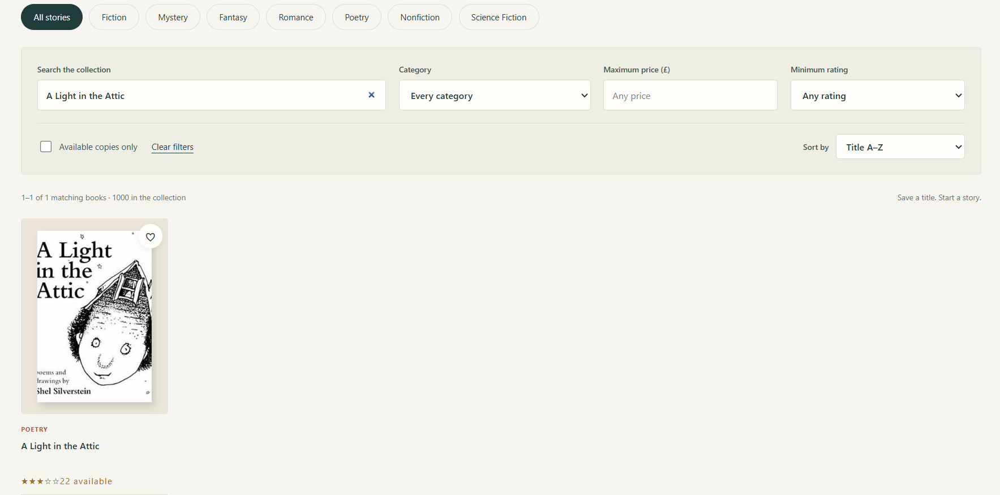

Combining **Business**, **maximum £30** and **minimum three stars** returned four matching books in the demonstrated collection.

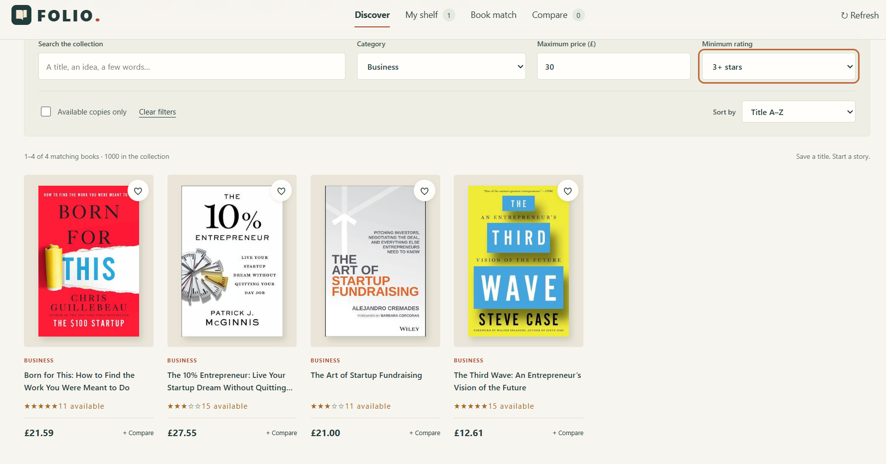

### Details and personal shelf

The detail view connects the source description to the recorded catalogue values. The identifier is explicitly labelled **UPC**, rather than incorrectly presented as an ISBN.

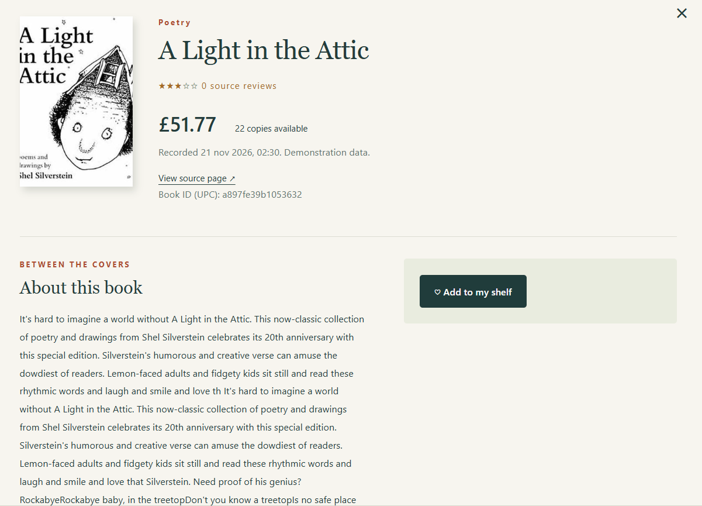

Saved books have a reading status and an optional note of up to 2,000 characters. Removing a book from the shelf also removes its saved note and status.

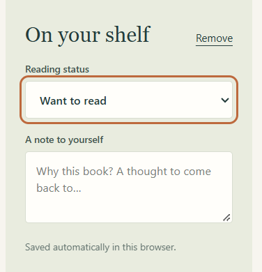

During manual testing, a saved book remained in My shelf after a browser reload. Compare selections disappeared after reload, as intended for temporary selections.

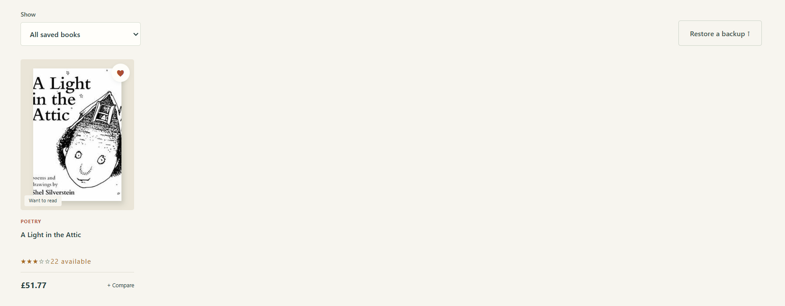

### History across collections

Each point represents a collection, **not necessarily a change**. These screenshots show three observations of the same book, with an unchanged price of £51.77 and unchanged stock of 22 copies. A flat line is therefore a valid result.

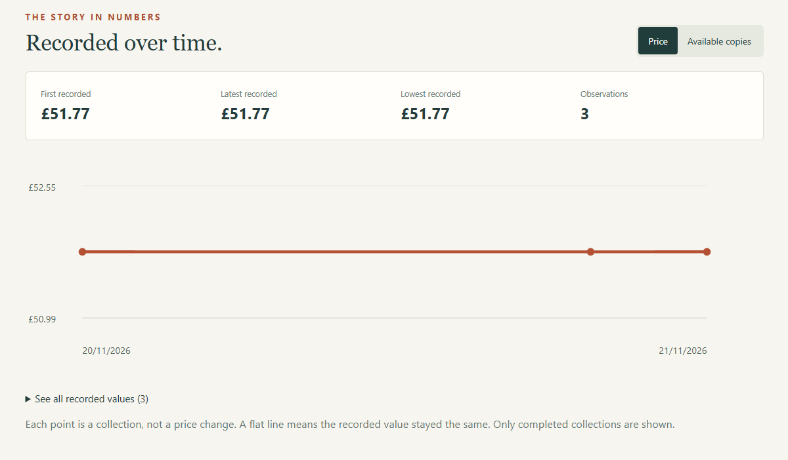

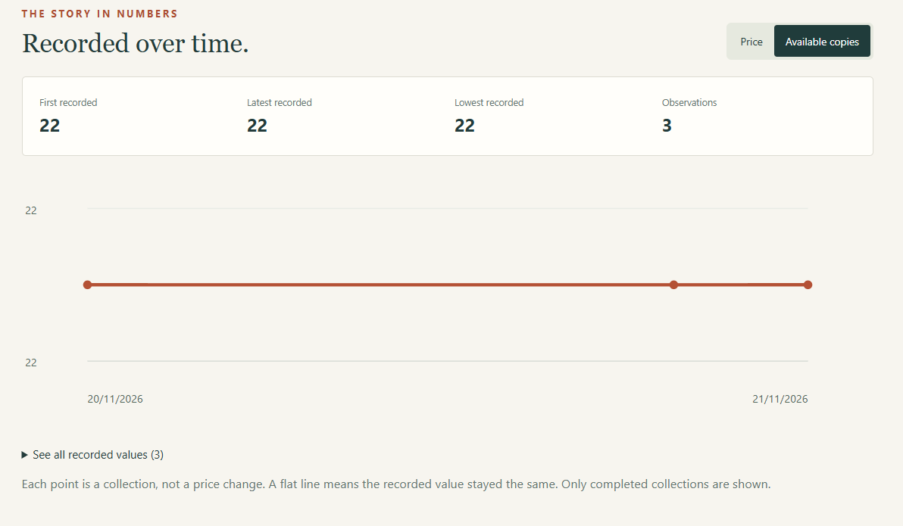

### Budget matching and comparison

Book match uses a random selection within the requested total budget. It is not an AI recommendation engine or an algorithm that guarantees the largest possible bundle.

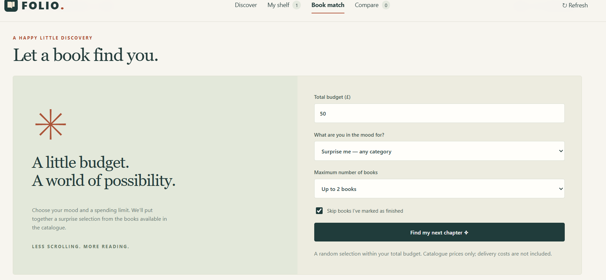

The demonstrated result selected two books at £11.11 and £38.13: **£49.24 in total**, within the £50 limit.

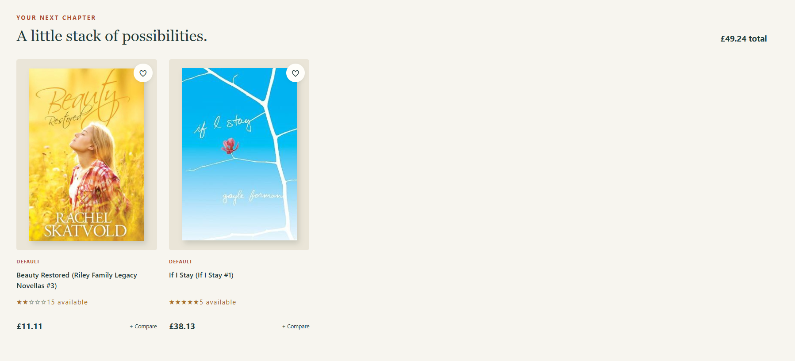

Comparison places selected books side by side. “Lowest in this comparison” refers only to the selected books.

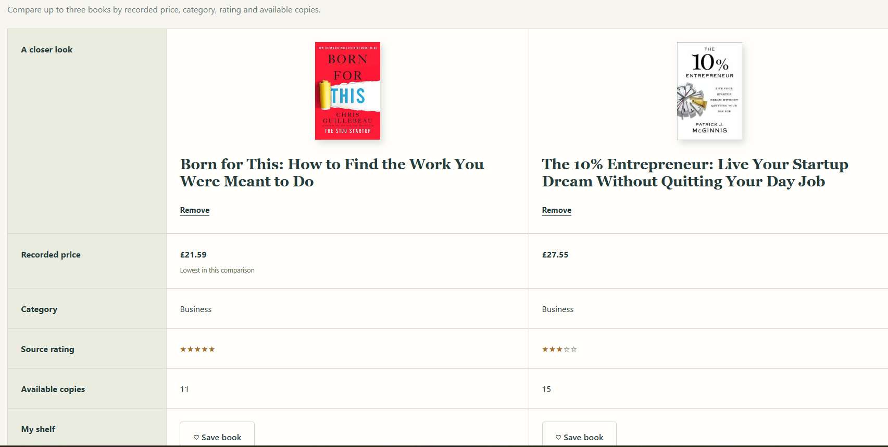

## 2. Data collection

The scraper uses **Python, Requests and Beautiful Soup**. It reads catalogue pages, follows each book's detail link and continues through pagination. It collects the fields exposed by the source instead of guessing missing information.

| Data group | Collected fields |
| --- | --- |
| Identification | Source UPC as `book_id`, title, product type and source URL |
| Classification | Category identifier, category name and category URL |
| Presentation | Description and cover image URL |
| Price | Price including tax, price excluding tax, tax and currency |
| Availability | Available copies and original availability text |
| Rating | Source star rating and review count |
| Timing | First/last seen timestamps, observation time and collection run identifiers |

Authors, publication dates, page counts and ISBNs are not available as consistent structured fields in this source and are not invented. Missing descriptions are allowed; two were absent in the first validated extraction.

The scraper includes request timeouts, retries for transient failures, a delay between requests, duplicate checks and restrictions on source URLs. Local checkpoints preserve progress. Runs have explicit statuses such as `completed`, `partial`, `failed` and `interrupted`; collecting some books is not treated as completing the catalogue.

Local history is stored in `data/history.json`. JSON and CSV exports are written under `output/<run-id>/`. These files are generated data, not credentials or website assets.

## 3. Persistence and database design

Four Supabase tables separate book information from repeated measurements:

| Table | Purpose | Main relationships |
| --- | --- | --- |
| `library_categories` | Stores category names and source URLs once. | `category_id` is the primary key. |
| `library_books` | Stores each book's current descriptive metadata, cover/source URLs and first/last seen times. | `book_id` is the primary key; `category_id` references categories. |
| `library_scrape_runs` | Records collection start/end times, status, expected/collected counts, pages and errors. | `run_id` identifies a collection. |
| `library_book_observations` | Stores the price, tax, currency, stock, rating and review count recorded for a book during a collection. | References both book and run; each `(run_id, book_id)` pair is unique. |

This design preserves earlier observations instead of replacing yesterday's price with today's. Re-uploading the same saved run does not intentionally create another observation for the same book/run pair. A genuinely new collection creates new observations even when values are unchanged.

`supabase_sync.py` uploads in batches and reads back observation identifiers and counts before finalising a run. This verification checks identifiers and counts, not every stored field. Uploads are not one transaction spanning all four tables.

FOLIO selects the latest completed run and displays that run's observations. Incomplete collections are excluded from public observation history by the configured policies. Descriptions and covers remain current book metadata; historical versions of those fields are not stored.

### Where personal data lives

| Information | Storage and lifetime |
| --- | --- |
| Catalogue and observation history | Supabase; shared catalogue data |
| Saved shelf, reading status and notes | Browser `localStorage`; retained across reloads when storage is available |
| Comparison selection | Memory for the current page session; resets on reload |
| Book match result | Temporary interface state |
| Shelf backup | A JSON file downloaded by the visitor |

There is no login or cross-device account sync. Shelf data is not sent to Supabase. Changing browser, clearing browser storage, or moving from `127.0.0.1` to the published website gives a different local shelf. Export/restore transfers it. When restoring duplicate books, existing shelf entries take precedence.

### Public access and credentials

The website uses a **publishable key** in `web/config.js`. The scraper uses a separate secret key from environment variables or a root `.env` file. The secret key must never be placed in browser code or committed to Git.

The owner-supplied metadata export of 24 November 2026 confirms Row Level Security is enabled on the four tables, with direct `anon` grants limited to SELECT. Policies allow category/book reads and restrict run/observation reads to completed collections. The server-side `service_role` has broader privileges, including DELETE and TRUNCATE, and must remain secret. The interface itself issues read requests. The export is not a complete permissions audit: inherited permissions, other exposed objects and live denied-write behaviour still require separate checks.

## 4. Setup and execution

### Open the published application

Visit **https://andpet03.github.io/books-library/**. No Python installation or account is needed to use the published interface. Internet access is required for Supabase data and source cover images.

### Run the interface locally on Windows

Download and extract the repository, or clone it. Open PowerShell in the `books-library` folder. With Python installed:

```powershell
py -m venv .venv
.\.venv\Scripts\python.exe -m pip install -r requirements.txt
.\.venv\Scripts\python.exe -m http.server 8000 --bind 127.0.0.1 --directory web
```

Open **http://127.0.0.1:8000** and keep PowerShell open. Press `Ctrl+C` to stop the server. Serving only `web` keeps the root environment file and local exports outside the served directory. A browser-only visit does not require the scraper's secret key.

The website is plain HTML, CSS and JavaScript, with system fonts and no frontend build step. The published configuration connects to this project's existing Supabase database.

### Run the scraper with your authorised database

For a **new Supabase project**, run [database/001_initial_schema.sql](database/001_initial_schema.sql) once in its SQL Editor as the database administrator. It creates the four empty tables, constraints, indexes and public-read policies. Follow [Database setup](docs/DATABASE_SETUP.md) for credentials, data loading and website configuration. **Do not run this initial setup against the existing FOLIO tables.** It intentionally fails on existing table names and does not modify the old `books` or `book_prices` tables.

Create `.env` in the project root with your own values:

```dotenv
SUPABASE_URL=https://YOUR_PROJECT_REF.supabase.co
SUPABASE_KEY=YOUR_SERVER_SIDE_SECRET_KEY
```

Keep `.env`, `.venv/`, generated `data/` and `output/`, and personal shelf backups out of the public repository. Confirm ignore rules before committing; browser uploads must also be selected carefully.

Run a full collection and upload:

```powershell
.\.venv\Scripts\python.exe update_library.py
```

Retry synchronisation of existing local history without collecting again:

```powershell
.\.venv\Scripts\python.exe update_library.py --sync-only
```

A short one-page trial is deliberately a partial collection:

```powershell
.\.venv\Scripts\python.exe update_library.py --pages 1
```

To collect locally without uploading:

```powershell
.\.venv\Scripts\python.exe books_scraper.py
```

Use one database writer at a time. Local lock files prevent overlapping processes in the same folder, while the GitHub workflow has its own concurrency group; these do not create a distributed lock between a personal computer and GitHub.

### Automatic collection and website deployment

Two separate GitHub Actions workflows serve different purposes:

| Workflow | Trigger and responsibility |
| --- | --- |
| `daily-update.yml` | Configured for 06:17 UTC each day, or a manual run. Runs Python tests, collects the source catalogue and synchronises Supabase. Uses repository secrets `SUPABASE_URL` and `SUPABASE_KEY`. |
| `deploy-website.yml` | Runs when relevant website/test/workflow files change on `main`, or manually. Runs interface tests and publishes only `web` to GitHub Pages. |

GitHub Pages uses **GitHub Actions** as its publishing source. Database updates do not require redeploying the website: FOLIO reads Supabase when opened or refreshed.

Scheduled execution is a daily update, not continuous monitoring or a guarantee of an exact start time. The website's Refresh button does not launch the scraper. The first manual cloud collection succeeded; automatic scheduled execution had not yet been independently confirmed in the captured evidence.

## 5. Development process and learning

The project was built incrementally, checking each stage before adding the next:

1. **Restart with a clear folder structure.** The earlier folder mainly contained a Python environment. A fresh `books-library` project made the source files, dependencies and generated data easier to distinguish.
2. **Extract the first 20 titles.** This confirmed basic requests and HTML parsing. It was a prototype, not the final catalogue coverage.
3. **Inspect one book in detail.** “A Light in the Attic” established the mapping for UPC, category, stock and price. This helped define which fields the interface could reliably use.
4. **Define the data model before expanding the UI.** The requirement grew to include every book, richer details, repeated observations and automatic updates. Categories, books, runs and observations were separated accordingly.
5. **Collect the full catalogue.** Pagination and detail requests produced 1,000 books across 50 pages, with zero reported collection errors. The first full local run took approximately 24 minutes.
6. **Import and verify Supabase data.** The first import reported 50 categories, 1,000 books, one run and 1,000 observations. The new `library_` tables kept the earlier experimental tables separate.
7. **Make updates repeatable.** Synchronisation added retries, duplicate avoidance, first-seen preservation and read-back checks. A second collection retained the earlier history. A missing local `update_library.py` file was resolved by placing the update files in the correct project folder.
8. **Move collection into GitHub Actions.** The first manually triggered cloud run succeeded in 19 minutes and 1 second, demonstrating that collection could run outside the local computer.
9. **Build FOLIO around the data.** The final interface added discovery, shelf management, history, comparison and budget-based matching. Public catalogue access uses a publishable key, while the scraper's secret remains server-side.
10. **Test the real user flows and publish.** Screenshots documented search, combined filters, details, three historical observations, comparison and a budget-compliant match. A browser reload confirmed that a saved shelf book remained. The Pages deployment then completed successfully in 21 seconds, and the owner confirmed the live site.

11. **Recover reproducible database setup.** The original SQL queries were no longer listed in the editor. A read-only metadata export supplied the current schema, constraints and access policies, allowing an initial setup script to be reconstructed without changing the live data.

The main learning was the distinction between **collecting data, storing data and displaying data**. Reloading the interface reads stored results; it does not collect new source data. Similarly, a book's identity and description are different from a measurement taken during a particular run, and a temporary comparison differs from a persistent personal shelf.

Other practical lessons included using a virtual environment, following pagination, validating relationships, recovering from upload failures, separating public configuration from secrets, and using screenshots as evidence of specific behaviours rather than proof that every feature has been tested.

### Cloud execution evidence

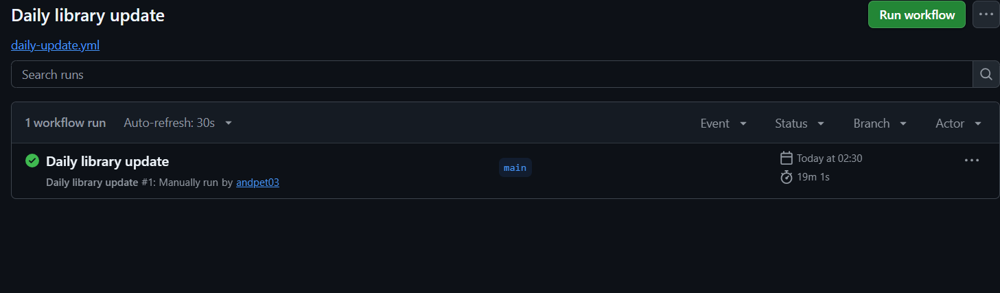

*The initial manual cloud collection completed in 19m 1s. This screenshot does not establish that the daily schedule subsequently ran.*

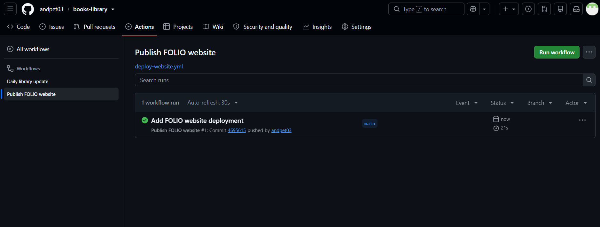

*The website deployment completed successfully in 21 seconds.*

## 6. Testing and evidence

Run Python tests from the repository root after installing the dependencies:

```powershell
.\.venv\Scripts\python.exe -m unittest discover -s tests -v
```

With Node.js installed, run the interface tests:

```powershell
node --test web-tests/core.test.cjs web-tests/api.test.cjs
```

| Evidence | What it supports |
| --- | --- |
| Nine offline synchronisation tests passed during development | Repeat uploads, retry handling, history retention, stale metadata handling and run/count validation using a simulated API |
| 23 interface tests passed during development | Filtering, sorting, budget calculations, escaping, backup validation, pagination and snapshot/API logic using fixtures or mocks |
| Successful cloud workflows | The configured test and execution/deployment steps completed in those runs |
| Supplied first-run history | 1,000 books, 50 categories and 1,000 observations, with validated identifiers and references |
| Browser screenshots and owner confirmation | Desktop rendering, live catalogue reads, shown interactions, saved-book persistence and deployment acceptance |

These are different forms of evidence. Mock tests do not prove live database security; screenshots do not establish mobile accessibility or all error paths. Note persistence, backup transfer, keyboard-only navigation, mobile layout and network-failure behaviour still need explicit acceptance checks. The shelf reload test confirmed the saved book, not a written note.

This README documents development and usage. It is **not the final publication audit**. The repository's `AUDIT.md` and the separate submission audit evidence PDF are separate deliverables.

## 7. Limitations, attribution and assistance

- The project depends on the source HTML structure, Supabase availability and remotely hosted cover images.
- The full catalogue is downloaded for the interface. Much larger catalogues or long histories would benefit from additional server-side querying and aggregation.
- Historical observations are preserved, but descriptions and covers are not versioned. Missing books remain in storage; Discover uses the latest completed collection.
- Category records are inserted if absent; later category renames are not automatically updated by the current synchronisation implementation.
- Batched uploads can leave an unfinished run after an interruption. They are not an all-or-nothing database transaction.
- The demo source may remain unchanged, producing flat charts. Such observations are retained rather than artificially creating price movement.
- The availability chart can show identical rounded axis labels for a constant series; the summary and value table provide the exact count.
- Book match is random and respects a total catalogue-price budget; it does not optimise preferences, ratings or bundle size, and excludes delivery charges.
- Shelf data belongs to the browser and site address. Clearing storage can remove it unless a backup exists. Comparison selections intentionally reset on reload.
- An initial database setup script is included and statically checked against the owner's exported metadata. Execution against a fresh Supabase instance remains to be verified; it is not an upgrade script for existing databases.

**Data and images:** Book metadata, descriptions and cover URLs come from Books to Scrape. Covers and descriptions remain attributable to their respective rights holders. The screenshots included here were captured by the project owner and show the interface using that source material; they do not imply ownership of book artwork.

**AI assistance:** ChatGPT/Codex assisted with architecture, Python and JavaScript implementation, debugging, test preparation, interface design, deployment guidance and documentation. The project owner defined requirements, refined the scope, ran the project, configured Supabase and GitHub, tested the interface and supplied the screenshots. This was an AI-assisted development process; generated code and documentation still require human review.

**Technology:** Python, Requests, Beautiful Soup, python-dotenv, Supabase/PostgreSQL, HTML, CSS, JavaScript, browser localStorage, Node.js tests, GitHub Actions and GitHub Pages. No analytics service is integrated into the application.
